# sb-audit

Audits Windows boot posture, including Secure Boot, TPM, and firmware mode. Explains what's blocking what.



sb-audit reports what needs attention but never attempts to change system configuration. Remediation is left to the user.

This tool helps diagnose what is preventing a system from meeting Secure Boot and TPM requirements. It doesn't bypass, disable, or circumvent them.

## Usage

Requires Windows, Python, and administrator rights.

```
python -m sb_audit
```

## Administrator privileges

Administrator rights are required for accurate hardware and firmware reporting. Without elevation, Windows can return incomplete or misleading results.

sb-audit does not elevate itself. Run it from an administrator terminal.

## Installation security 

Install sb-audit somewhere only administrators can modify.

The tool executes `boot_posture.ps1` from its installation directory with administrator privileges. If a non-administrator can modify that script, they could execute arbitrary code with elevated permissions.
